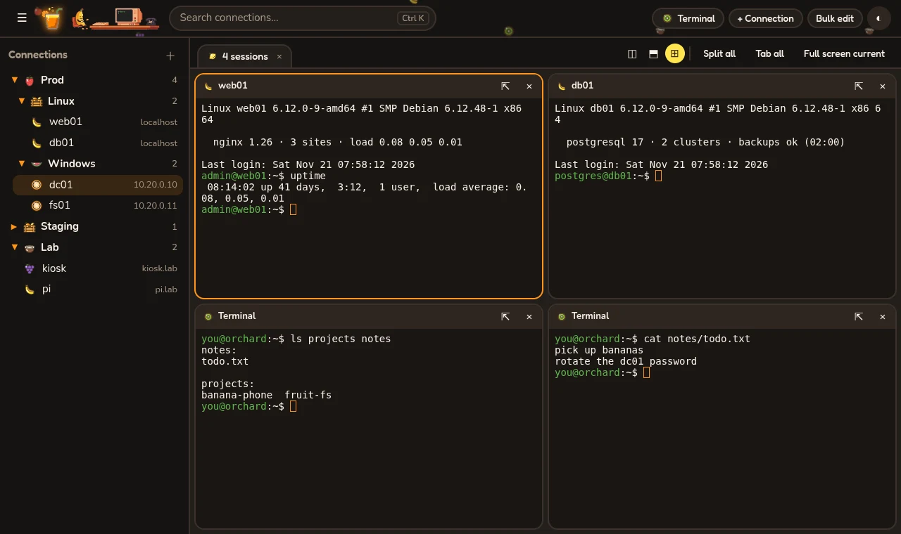
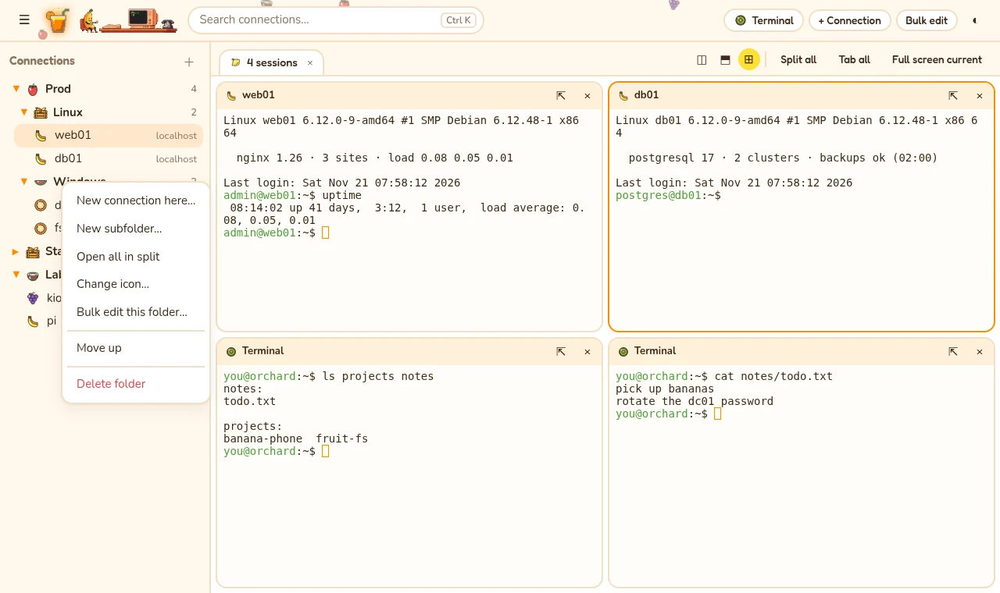

# banana-phone 🍌📞


A small, fruity connection manager for Linux: SSH and local terminals, plus RDP (including Active Directory logins) and VNC desktops, in tabs or split views of up to eight sessions. Connections live in a collapsible folder tree, are searchable with Ctrl+K, and their credentials can be bulk-edited by username or by folder.


## Features

- **Tabs and splits.** Open sessions in tabs, side by side, stacked, or in a grid, up to eight in a tab. Right-click a pane's header → Split right / Split down to split just that pane; splits can be nested. Drag the gutter between panes to resize them, drag a pane onto another tab, and pop any session out into its own tab. Tabs are grouped by the folder their connections are in, with the folder's icon and name in front of each group.
- **Tab right-click menu.** Rename a tab, duplicate or reconnect it, change its layout, pull every session into it or give each its own tab, and close it, the others, or the ones to its right.
- **Full screen current.** Ctrl+Alt+F makes the active session fill the whole screen. A faint banana at the top brings back Minimize and Back to tab, and says so if the session shares a folder.
- **Send Ctrl+Alt+Del.** Your own computer takes that key combination, so for a remote desktop it is an option instead: right-click the session's header, or use the button under the banana in full screen.
- **Folders.** Group connections in nested folders in a collapsible sidebar (Ctrl+B hides it); drag its right edge to make it wider or narrower. Right-click a folder to open everything in it as a split, add a subfolder, or bulk edit it.
- **Drag to reorganize.** Drag connections and folders to reorder them or nest one folder in another; the order is saved. Move up / Move down in the right-click menu do the same from the keyboard.
- **Folder fruit icons.** Right-click a folder → Change icon… and pick a fruit, or the crate to go back to the default. Folders without one show a crate.
- **Quick search.** Ctrl+K finds connections by name, host, user, folder or tag. Enter opens a result, Shift+Enter opens it in a split.
- **Bulk credential edit.** Change the username, domain or password of every connection with a given username, or in a folder, after previewing exactly which ones will change. A backup is kept.
- **Saved commands.** SSH and local terminal connections can keep named commands (edit the connection → Saved commands). Run one from the right-click menu of the connection or of its open pane, or tick Run on start to have it typed in as soon as the session opens. Saved commands are stored in plain text in the connections file (only passwords are encrypted), so don't put secrets in them.
- **SSH, RDP, VNC and local terminals.** RDP supports Active Directory logins (domain, user, password) and admin sessions, and its pane closes when you sign out of Windows.
- **Remote Desktop Gateway.** For a Windows server that is only reachable through a gateway (RDP carried over HTTPS): edit the RDP connection → tick Through a gateway, and fill in the gateway, the account there, and the SHA-256 fingerprint of the server's certificate. The server cannot be reached from outside to read its certificate, so you write it down once; banana-phone shows it when you connect to that server directly, from inside its network. The gateway's own certificate is remembered on first connect, and the server must use NLA. Not yet tried against a real gateway.
- **Identity checks.** SSH host keys and RDP certificates are remembered on first connect. If one changes, you're shown both fingerprints and asked whether to trust it, with Cancel as the default.
- **Clipboard sharing** with RDP and VNC desktops, as text. Each connection can share it both ways, one way only, or not at all (edit the connection → Clipboard).
- **RDP and VNC without Docker.** They normally run through guacd in Docker. Where Docker is not installed, a `guacd` installed on the computer (1.6.0 or newer, on the `PATH`) is started instead, on localhost only, and stopped when you quit. Shared folders still need Docker. **On a computer other people also log in to, use Docker:** the installed guacd runs as you on a localhost port that needs no password, so any other account there can connect to it and have it show your home folder as a drive to an RDP server of its choosing. guacd has no login of its own and cannot listen on a unix socket, so the app cannot close that port to others; Docker's guacd runs in a container that holds none of your files.
- **Shared folders (RDP).** Edit an RDP connection → Shared folders → Choose…, and pick a folder on this computer in the system's folder dialog (the path cannot be typed in). Windows shows it as the drive "Shared on banana-phone" (`\\tsclient\Shared`). Add more folders and each becomes a folder in that drive under its own name (`\\tsclient\Shared\Projects`; two with the same name become `Documents` and `Documents (2)`), up to eight. The session's header says "shared folder: read-only" or "writable" (with several, how many there are and how many can be changed) for as long as it is open, and so does the banana in full screen. Each folder is read-only unless you tick otherwise, and you are asked to agree the first time you connect, and again if the list of folders, the server or the account changes. Only those folders are mounted for the session, and a read-only share is read-only all the way down, drives mounted inside it included (this needs Docker Engine 25 or newer). Shared folders always need Docker, also where RDP itself runs on an installed guacd. Your home folder as a whole, hidden folders in it and system folders cannot be shared. See [what has been checked](docs/shared-folders-check.md).
- **Saved passwords encrypted** with your system keyring, and never shown to the window. A saved password stays with its server and account: change the host, port, type or username of a connection (or of a duplicate) and you enter it again.
- **Juice cup status.** The cup in the top bar is empty  when nothing is open, and full and glowing  as soon as a connection tab is open.
- **Light and dark themes.**

| Quick search (Ctrl+K) | Bulk edit by username or folder |
|---|---|
|  |  |
| **Editing an RDP connection** | **Dark theme** |
|  |  |
| **Folder right-click menu** | **Picking a folder's fruit icon** |
|  |  |

Screenshots use made-up hosts and names.

```bash
npm install
npm start          # run from source
npm run dist       # build dist/banana-phone-<version>.AppImage
```

## Running the AppImage on another machine

Download `banana-phone-<version>.AppImage` from the [latest release](https://github.com/zelder-bit/banana-phone/releases/latest), or build it with `npm run dist`. Only that file is needed, but the machine needs FUSE 2, Docker (or, without Docker, an installed guacd 1.6.0 or newer) for RDP/VNC, and a keyring for saved passwords: see [requirements.txt](requirements.txt) for the full list.

## Releasing

Bump `version` in `package.json`, merge to `main`, then tag that commit:

```bash
git tag v0.4.0 && git push origin v0.4.0
```

The Release workflow runs the tests and the walkthrough check, builds the AppImage, and publishes a GitHub release with the AppImage and `requirements.txt` attached. The tag must match the version in `package.json`.

## Before your first push

Turn on the pre-push scan for secrets and personal data (once per clone):

```bash
git config core.hooksPath .githooks
```

GitHub runs the same scan on every push and pull request.

How it all works, file by file: [WALKTHROUGH.md](WALKTHROUGH.md).
