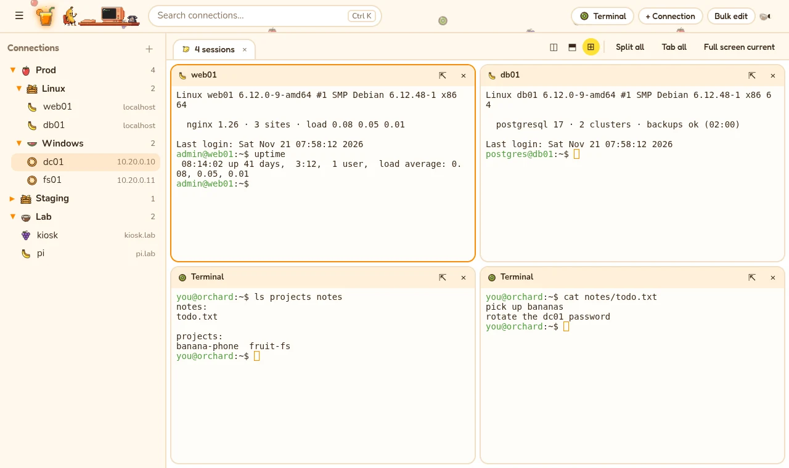
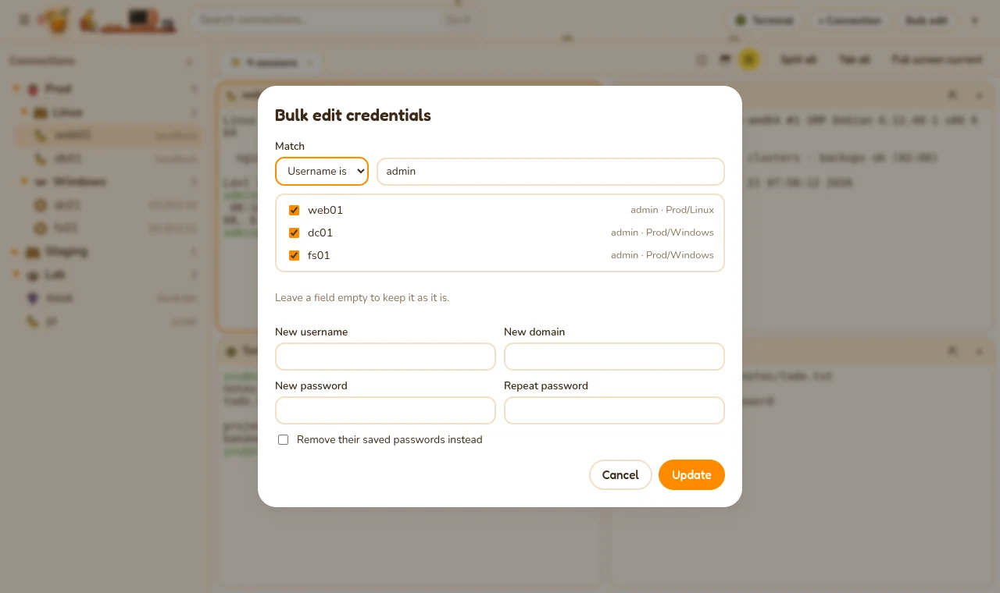

# banana-phone 🍌📞


A small, fruity connection manager for Linux: SSH and local terminals, plus RDP (including Active Directory logins) and VNC desktops, in tabs or split views of up to eight sessions. Connections live in a collapsible folder tree, are searchable with Ctrl+K, and their credentials can be bulk-edited by username or by folder.



## Features

- **SSH, RDP, VNC and local terminals.** RDP supports Active Directory logins, admin sessions and Remote Desktop Gateways (gateway support has not yet been tried against a real gateway).
- **Tabs and splits.** Side by side, stacked, a grid, or nested splits (right-click a pane's header), up to eight sessions per tab. Drag gutters to resize, drag panes between tabs. Right-click a tab to rename, duplicate, reconnect or close it.
- **Full screen** (Ctrl+Alt+F), with a faint banana at the top for Minimize, Back to tab and Send Ctrl+Alt+Del.
- **Folders** with fruit icons, in a resizable sidebar (Ctrl+B). Drag to reorder and nest; open a whole folder as a split.
- **Quick search** (Ctrl+K) by name, host, user, folder or tag.
- **Bulk credential edit** by username or folder, with a preview and a backup.
- **Saved commands** for SSH and local terminals, run from a menu or on start. They are stored in plain text, so keep secrets out of them.
- **Identity checks.** SSH host keys and RDP certificates are remembered on first connect, and you are asked before a changed one is trusted.
- **Clipboard sharing** with RDP and VNC, as text: both ways, one way or off, per connection.
- **Shared folders (RDP).** Up to eight folders of this computer, chosen in the folder dialog, read-only unless you tick otherwise. You agree once per folder list, server and account. Needs Docker. See [what has been checked](docs/shared-folders-check.md).
- **Saved passwords** are encrypted with your system keyring, never shown to the window, and kept only for the server and account they were saved for.
- **Without Docker,** RDP and VNC use an installed `guacd` 1.6.0 or newer. On a computer other people log in to, use Docker: an installed guacd is a localhost port with no password that any account there can use.
- **Juice cup status**   and **light and dark themes**.

| Quick search (Ctrl+K) | Bulk edit by username or folder |
|---|---|
|  |  |
| **Editing an RDP connection** | **Dark theme** |
|  |  |
| **Folder right-click menu** | **Picking a folder's fruit icon** |
|  |  |

Screenshots use made-up hosts and names.

```bash
npm install
npm start          # run from source
npm run dist       # build dist/banana-phone-<version>.AppImage
```

## Running the AppImage on another machine

Download `banana-phone-<version>.AppImage` from the [latest release](https://github.com/zelder-bit/banana-phone/releases/latest), or build it with `npm run dist`. Only that file is needed, but the machine needs FUSE 2, Docker (or, without Docker, an installed guacd 1.6.0 or newer) for RDP/VNC, and a keyring for saved passwords: see [requirements.txt](requirements.txt) for the full list.

## Releasing

Bump `version` in `package.json`, merge to `main`, then tag that commit:

```bash
git tag v0.5.0 && git push origin v0.5.0
```

The Release workflow runs the tests and the walkthrough check, builds the AppImage, and publishes a GitHub release with the AppImage and `requirements.txt` attached. The tag must match the version in `package.json`.

## Before your first push

Turn on the pre-push scan for secrets and personal data (once per clone):

```bash
git config core.hooksPath .githooks
```

GitHub runs the same scan on every push and pull request.

How it all works, file by file: [WALKTHROUGH.md](WALKTHROUGH.md).
