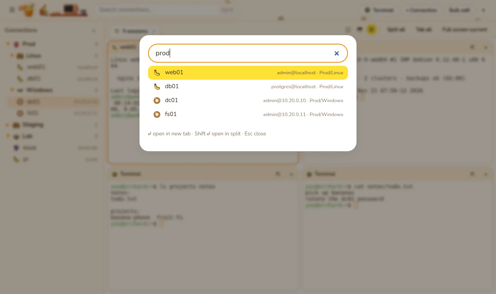

# banana-phone 🍌📞

A small, fruity connection manager for Linux: SSH and local terminals, plus RDP (including Active Directory logins) and VNC desktops, in tabs or split views of up to four sessions. Connections live in a collapsible folder tree, are searchable with Ctrl+K, and their credentials can be bulk-edited by username or by folder.


## Features

- **Tabs and splits.** Open sessions in tabs, side by side, stacked, or in a 2×2 grid. Drag the gutter between panes to resize them, and pop any session out into its own tab.
- **Folders.** Group connections in nested folders in a collapsible sidebar (Ctrl+B hides it).
- **Quick search.** Ctrl+K finds connections by name, host, user, folder or tag. Enter opens a result, Shift+Enter opens it in a split.
- **Bulk credential edit.** Change the username, domain or password of every connection with a given username, or in a folder, after previewing exactly which ones will change. A backup is kept.
- **SSH, RDP, VNC and local terminals.** RDP supports Active Directory logins (domain, user, password).
- **Identity checks.** SSH host keys and RDP certificates are remembered on first connect. If one changes, you're shown both fingerprints and asked whether to trust it, with Cancel as the default.
- **Clipboard sharing** with RDP and VNC desktops.
- **Saved passwords encrypted** with your system keyring, and never shown to the window.
- **Light and dark themes.**

| Quick search (Ctrl+K) | Bulk edit by username or folder |
|---|---|
|  |  |
| **Editing an RDP connection** | **Dark theme** |
|  |  |

Screenshots use made-up hosts and names.

```bash
npm install
npm start          # run from source
npm run dist       # build dist/banana-phone-<version>.AppImage
```

## Running the AppImage on another machine

Download `banana-phone-<version>.AppImage` from the [latest release](https://github.com/zelder-bit/banana-phone/releases/latest), or build it with `npm run dist`. Only that file is needed, but the machine needs FUSE 2, Docker for RDP/VNC, and a keyring for saved passwords: see [requirements.txt](requirements.txt) for the full list.

## Releasing

Bump `version` in `package.json`, merge to `main`, then tag that commit:

```bash
git tag v0.1.3 && git push origin v0.1.3
```

The Release workflow runs the tests and the walkthrough check, builds the AppImage, and publishes a GitHub release with the AppImage and `requirements.txt` attached. The tag must match the version in `package.json`.

## Before your first push

Turn on the pre-push scan for secrets and personal data (once per clone):

```bash
git config core.hooksPath .githooks
```

GitHub runs the same scan on every push and pull request.

How it all works, file by file: [WALKTHROUGH.md](WALKTHROUGH.md).
